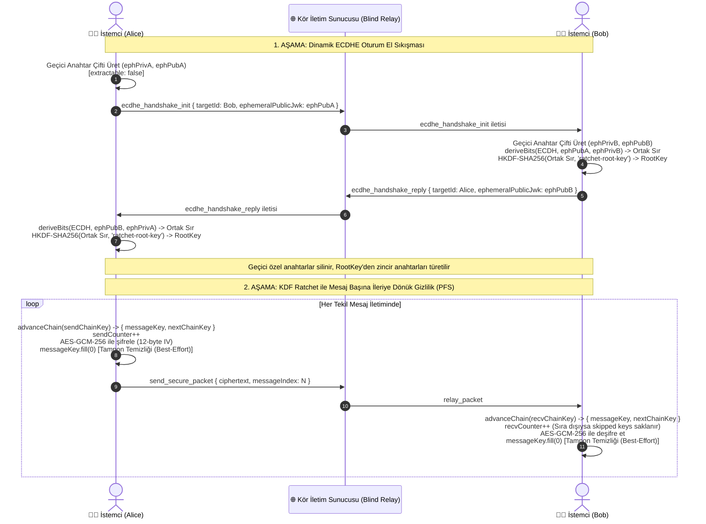
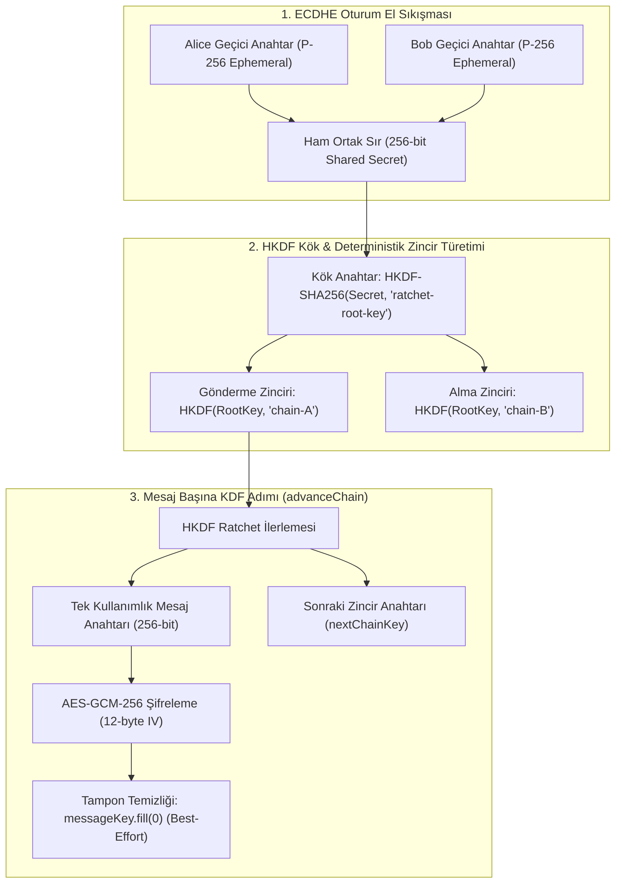

# 🔐 Siber E2EE Sohbet Terminali (v1)

> **Uçtan Uca Şifreli (E2EE) P2P Sohbet Terminali** — Sunucu yalnızca signaling ve paket iletimi (blind relay) görevi görür; uçtan uca şifrelenmiş içerikleri çözemez veya inceleyemez.


[](https://github.com/arifoztr/Cyber_Chat_Terminal/actions/workflows/test.yml)


-blue)


-cyan)


---

> [!WARNING]
> ### ⚠️ EĞİTİM, ARAŞTIRMA VE PORTFOLYO PROJESİDİR (SORUMLULUK REDDİ)
> Bu yazılım; modern uçtan uca şifreleme (E2EE) mimarilerini, Web Crypto API standartlarını ve simetrik anahtar rotasyonunu (KDF Ratchet) pratik üzerinde incelemek amacıyla geliştirilmiş **deneysel bir öğrenme ve portfolyo çalışmasıdır**.
> 
> - **Bağımsız Güvenlik Denetimi Yoktur:** Kod tabanı bağımsız bir kriptografi veya bilgi güvenliği kuruluşu tarafından resmi bir güvenlik ve kod denetiminden (cryptographic audit / penetration test) geçmemiştir.
> - **Operasyonel Güvenlik Sağlamaz:** Gerçek kişilerin hassas, gizli veya güvenlik riski taşıyan gerçek dünya iletişimleri için **kesinlikle kullanılmamalıdır**.
> - **Kriptografi İddiaları Hakkında:** Kriptografik sistemlerde güvenlik "askeri düzey", "kırılamaz" gibi pazarlama iddialarıyla değil; matematiksel modeller, şeffaf tehdit modelleri ve bağımsız denetim raporlarıyla ispatlanır. Bu doküman, projenin sınırlarını ve mimari kabullerini şeffaflıkla açıklar.

---

## 📌 Proje Özeti

Bu proje, modern web tarayıcıları ve Electron masaüstü uygulaması arasında **ECDHE (Elliptic-curve Diffie–Hellman Ephemeral, P-256)** ile her oturum için dinamik tek kullanımlık geçici anahtarlar üreten, her mesajda **KDF Ratchet (HKDF-SHA256)** zinciri ile simetrik anahtar rotasyonu yapan ve tüm yükleri **AES-GCM-256** ile şifreleyen bir P2P sohbet platformu prototipidir.

Sistem, oturum başında tek kullanımlık anahtar çiftleri ve tek yönlü HKDF fonksiyonu kullanarak **İleriye Dönük Gizlilik (Forward Secrecy - PFS)** sağlar. Sunucu mimarisi **Kör İletim (Blind Relay / Content-Oblivious)** prensibiyle tasarlanmıştır; sunucu istemciler arasındaki şifreli zarfları taşır ve içeriği deşifre edebilecek anahtarlara hiçbir zaman erişemez. Bununla birlikte, kimin kiminle ne zaman konuştuğu gibi iletişim üst verileri (metadata) sunucu düzeyinde görünür durumdadır (ayrıntılar için [Kriptografik Sınırlar](#3-kriptografik-sınırlar-ve-açık-tehdit-modeli) bölümünü inceleyiniz).

---

### 🌟 Öne Çıkan Özellikler

- 🔐 **Uçtan Uca Şifreleme (E2EE) & ECDHE:** İstemciler arası oturum bazlı geçici (ephemeral) P-256 anahtar çiftleri ile ECDHE el sıkışması; kalıcı kimlik anahtarları tehlikeye girse dahi geçmiş oturum trafiği çözülemez (**Forward Secrecy - PFS**).
- ⚙️ **KDF Ratchet Zinciri (Simetrik Anahtar Rotasyonu):** HKDF-SHA256 tabanlı simetrik cırcır (ratchet) mimarisi. Her gönderilen ve alınan mesaj için tek kullanımlık benzersiz anahtar türetilir ve zincir anında bir sonraki adıma ötelenir.
- 🔀 **Sıra Dışı Paket Toleransı (Out-of-Order Handling):** Ağ gecikmeleri nedeniyle sıra dışı gelen paketler için atlanan mesaj anahtarları (`_skippedMessageKeys`) önbelleğe alınır; paketler desync (senkronizasyon kaybı) olmadan eksiksiz çözülür.
- 🔒 **Dışa Aktarılamaz Anahtarlar (`extractable: false`) & Savunma Derinliği:** Kriptografik özel anahtarlar Web Crypto katmanında kilitlenir; doğrudan JS ile dışa aktarılamaz. Ara bayt tamponları için `fill(0)` ile en iyi çaba (best-effort) tampon temizliği uygulanır.
- 🛡️ **Donanım / İşletim Sistemi Kasası (Electron safeStorage):** Masaüstü uygulamasında depolanan IndexedDB anahtarları ve yetki belirteçleri Windows'ta DPAPI, macOS'ta Keychain ve Linux'ta Secret Service API'si ile şifrelenir.
- 🛡️ **Sıfır Dış CDN & Sıkı CSP:** Tüm istemci kütüphaneleri (Tailwind CSS, Socket.IO, QR Code) yerel (`public/vendor/`) olarak barındırılır. Katı Content-Security-Policy kuralları ile üçüncü taraf kaynak ve script enjeksiyonları tamamen engellenmiştir.
- 💻 **Çapraz Platform Masaüstü:** Electron tabanlı güvenli masaüstü istemcisi; **Windows** (`.exe`), **Linux** (`.deb`, `.AppImage`) ve **macOS** (`.dmg`, `.zip`) için optimize derlemeler.
- 👤 **Profil & Hesap Yönetimi:** Kullanıcı avatarı belirleme/güncelleme (Canvas üzerinde istemci tarafı optimizasyon), eski şifre doğrulamalı şifre güncelleme ve tüm verileri, kuyrukları anında temizleyen güvenli hesap silme.
- 🔍 **Ajan Arama & Bağlantı Talepleri:** Benzersiz Ajan ID (`AGN-XXXX-XXXX`) veya kullanıcı adı ile arama, onaylı bağlantı isteği (Accept/Reject) akışı.
- 🔗 **Akıllı & Güvenli Bağlantı Tıklama (Smart URL Detection):** Mesajlardaki `http://`, `https://` ve `www.` bağlantıları otomatik algılanır; XSS korumalı güvenli etiketlere (`target="_blank"`, `rel="noopener noreferrer"`) dönüştürülerek açılır.
- 📄 **Uçtan Uca Şifreli Dosya & PDF Aktarımı:** Görseller ve PDF belgeleri (maks. 5 MB) istemcide şifrelenerek güvenle gönderilir; siber kart yapısı üzerinden dahili PDF önizleme ve indirme desteği.
- ⏱️ **TTL (Zaman Ayarlı İmha):** Belirlenen süre (5s, 10s, 30s, 60s) sonunda mesajlar hem arayüzden hem de yerel IndexedDB kasasından otomatik ve kalıcı olarak imha edilir. Sekme arka plandan döndüğünde süresi dolmuş tüm iletiler anında silinir (`SEC-18`).
- 🗑️ **Revoke Protokolü (Herkesten Sil):** Gönderici dilediği an iletisini iki taraftan birden silebilir (Sunucu tarafı BOLA yetkilendirme doğrulamalı).
- 📴 **Kalıcı Çevrimdışı Kuyruk (Offline Queue):** Karşı taraf çevrimdışı olsa bile paketler SQLite üzerinde şifreli olarak kuyruklanır ve kullanıcı bağlandığında otomatik teslim edilir (7 günlük otomatik çöp toplayıcı GC).
- 🪪 **Parmak İzi (Fingerprint) Doğrulama:** Ortadaki Adam (MITM) saldırılarını engellemek amacıyla ECDH açık anahtarları üzerinden SHA-256 parmak izi ve Safety Number doğrulama rehberi.
- 🔊 **Siber Ses Geri Bildirimleri:** Web Audio API sentezleyici ile üretilen fütüristik siber ses efektleri (yazma, paket iletimi, hata, başarı sesleri).
- ⚡ **Yazıyor... & Durum Takibi:** Gerçek zamanlı yazıyor göstergesi, çevrimiçi/çevrimdışı durum takibi ve bağlantı koptuğunda otomatik yeniden bağlanma (Auto-reconnect) katmanı.
- 🧪 **Kapsamlı Test Altyapısı:** Vitest ve v8 coverage motoru ile koşan 190 birim, entegrasyon ve kripto testi (%99+ ifade kapsama oranı).
- 📚 **Tam JSDoc Dökümantasyonu:** Kod tabanındaki tüm backend, istemci ve Electron modülleri JSDoc standartlarında açıklanmış, `npm run docs` ile tek tıkla zengin HTML dökümantasyonu üretilebilir.

---

## 🧰 Teknoloji Yığını

| Alan | Teknoloji / Standart | Açıklama |
|------|----------------------|----------|
| **Frontend** | Vanilla JavaScript (ES6+), Tailwind CSS (Yerel) | Framework bağımsız, harici CDN gerektirmeyen, hafif ve hızlı arayüz |
| **Backend** | Node.js, Express, Socket.IO | Asenkron, modüler, olay tabanlı sinyal ve kör iletim (blind relay) sunucusu |
| **Kriptografi & Protokol** | Web Crypto API (`window.crypto.subtle`), HKDF-SHA256 | Tarayıcı yerel ECDHE (P-256), KDF Ratchet, AES-GCM-256, SHA-256, PBKDF2 |
| **Masaüstü** | Electron 44, electron-builder | Sandbox, Context Isolation ve tekil oturum kilidi (Single Instance Lock) |
| **Kimlik & Oturum** | JWT (HMAC-SHA256) + bcrypt | Bağımlılıksız token imzalama, güvenli şifre hashleme |
| **Veritabanı** | Hibrit: SQLite (WAL Modu) veya Turso Bulut SQLite (@libsql/client) | Ortam değişkeniyle yerel SQLite veya bulut veritabanı seçimi; bellek-içi önbellek ve debounced flush |
| **İstemci Depolama** | IndexedDB (Vault) + Electron safeStorage | Mesaj geçmişi istemcide; masaüstünde DPAPI / Keychain ile şifreli donanım kasası |
| **Test & Kalite** | Vitest, @vitest/coverage-v8 | 190 test senaryosu, %99+ ifade kapsamı |
| **Dökümantasyon** | JSDoc 3, Markdown Eklentisi | HTML API dökümantasyon motoru (`npm run docs`) |
| **Tipografi & Stil** | Inter, JetBrains Mono | Okunabilir modern siber terminal estetiği |

---

## 📁 Proje Dizin Yapısı

```text
/
├── .github/                               # GitHub Actions CI/CD iş akışları
│   └── workflows/
│       ├── test.yml                       # Otomatik test ve coverage CI iş akışı
│       ├── build-linux.yml                # Linux (.deb, .AppImage) otomatik derleme
│       └── build-mac.yml                  # macOS (.dmg, .zip) otomatik derleme
├── public/                                # İstemci tarafı statik dosyaları
│   ├── index.html                         # Ana web & Electron arayüzü
│   ├── config.js                          # İstemci yapılandırması (Backend URL vb.)
│   ├── style.css                          # Modern siber tema, animasyonlar ve bileşenler
│   ├── crypto.js                          # Web Crypto API tabanlı E2EE kripto motoru
│   ├── db.js                              # IndexedDB yerel kasa (Vault) yönetimi
│   ├── ui.js                              # UI etkileşimi, state yönetimi, render işlemleri
│   ├── socket-handlers.js                 # Socket.IO istemci olay dinleyicileri
│   ├── icon.png                           # Uygulama simgesi
│   └── vendor/                            # Sıfır CDN: Yerel saklanan üçüncü taraf scriptler
│       ├── tailwindcss.js                 # Yerel Tailwind CSS motoru
│       ├── socket.io.min.js               # Yerel Socket.IO istemcisi
│       └── qrcode.min.js                  # Yerel QR kod üretici
├── src/                                   # Backend kaynak kodları
│   ├── server.js                          # Express HTTP sunucusu & güvenlik katmanı (CSP, HSTS)
│   ├── socket.js                          # Socket.IO sunucu olay işleyicileri & relay mantığı
│   └── database.js                        # SQLite/Turso veritabanı sürücüsü, önbellek ve GC (database.sqlite runtime'da üretilir ve gitignore'dadır)
├── electron/                              # Masaüstü (Electron) kabuğu
│   ├── main.js                            # Electron ana süreç (pencere, IPC, güvenlik sandbox)
│   ├── preload.js                         # Güvenli IPC köprüsü (Context Isolation)
│   └── assets/                            # Uygulama simgeleri (icon.png, icon.jpg)
├── tests/                                 # Kapsamlı otomatik test paketi (Vitest)
│   ├── auth.test.js                       # Kimlik doğrulama, token ve şifreleme testleri
│   ├── crypto.test.js                     # ECDH, AES-GCM ve parmak izi testleri
│   ├── database.test.js                   # SQLite / Turso sürücü ve GC testleri
│   ├── e2ee-message.test.js               # Uçtan uca mesaj yaşam döngüsü testleri
│   ├── server.test.js                     # Express middleware, CSP ve endpoint testleri
│   └── socket.test.js                     # Socket.IO olayları, kuyruk ve hız limiti testleri
├── docs/                                  # Proje teknik belgeleri
│   ├── DEPLOYMENT.md                      # Hibrit bulut dağıtım kılavuzu (Cloudflare + Bulut)
│   ├── OPTIMIZATIONS.md                   # Güvenlik ve performans optimizasyon detayları
│   ├── PROGRESS.md                        # Faz durumu ve sürüm yol haritası
│   ├── AGENTS.md                          # AI asistanı ve geliştirici standartları kılavuzu
│   └── api/                               # JSDoc tarafından derlenen HTML API dökümantasyonu
├── 1-install-windows-environment.bat      # [1] Windows Node.js, .env ve bağımlılık kurulum betiği
├── 1-install-wsl-environment.sh           # [1] Linux/WSL ortam ve bağımlılık kurulum betiği
├── 2-start-dev-windows.bat                # [2] Windows sunucu ve masaüstü geliştirici başlatıcısı
├── 2-start-dev-linux.sh                   # [2] Linux/WSL sunucu ve masaüstü geliştirici başlatıcısı
├── 3-format-code.bat                      # [3] Windows JS sözdizimi doğrulama ve Prettier formatlama
├── 3-format-code.sh                       # [3] Linux/WSL JS sözdizimi doğrulama ve Prettier formatlama
├── 4-build-doc-windows.bat                # [4] Windows JSDoc HTML API dokümantasyon derleyicisi
├── 4-build-doc-linux.sh                   # [4] Linux/WSL JSDoc HTML API dokümantasyon derleyicisi
├── 5-build-test-windows.bat               # [5] Windows birim testleri ve v8 kapsam (coverage) raporu
├── 5-build-test-linux.sh                  # [5] Linux/WSL birim testleri ve v8 kapsam (coverage) raporu
├── 6-build-app-windows.bat                # [6] Windows .exe (Setup + Portable) masaüstü derleyicisi
├── 6-build-app-linux.sh                   # [6] Linux (.deb/.AppImage) ve macOS (.dmg) derleyicisi
├── 7-clean-project.bat                    # [7] Windows derleme çıktıları ve geçici dosya temizleyici
├── 7-clean-project.sh                     # [7] Linux/WSL derleme çıktıları ve geçici dosya temizleyici
├── jsdoc.json                             # JSDoc yapılandırma dosyası
├── Dockerfile                             # Konteynerize dağıtım dosyası
├── electron-builder.json                  # Çoklu platform masaüstü paketleme yapılandırması
├── vitest.config.mjs                      # Test ortamı ve v8 coverage yapılandırması
├── wrangler.toml                          # Cloudflare Pages yapılandırması
├── .env.example                           # Ortam değişkenleri şablonu
├── package.json                           # Proje bağımlılıkları ve npm betikleri
└── README.md                              # Proje dokümantasyonu (Bu dosya)
```

---

## 🚀 Kurulum ve Başlatma

### Gereksinimler
- **Node.js:** v18.0.0 veya üzeri (v20+ önerilir)
- **npm:** v9.0.0 veya üzeri (ya da Docker)

---

### 💻 Yöntem 1: Windows Masaüstü Uygulaması (.exe) Olarak Kurulum

Cyber Chat Terminal, uzaktaki veya yereldeki sunucuya bağlanan bir Windows masaüstü uygulaması olarak kullanılabilir.

#### 1. Hazır Kurulum Dosyaları ile Kullanım
GitHub Releases bölümünden derlenen dosyalarla:
- **Kurulum Sihirbazı (Setup):** `Cyber Chat Terminal Setup 1.0.0.exe`  
  Çift tıklayıp kurulum sihirbazını tamamlayın. Masaüstünüze ve Başlat Menünüze otomatik kısayol eklenir.
- **Taşınabilir Sürüm (Portable):** `Cyber Chat Terminal 1.0.0.exe`  
  Kurulum gerektirmez. Çift tıkladığınız anda doğrudan açılır, USB bellek üzerinden çalıştırılabilir.

#### 2. Kendi Masaüstü Paketlerinizi (.exe) Derlemek
```bash
# 1. Bağımlılıkları yükleyin
npm install

# 2. Geliştirici modunda test etmek için:
npm run desktop:start

# 3. Windows Installer ve Portable .exe paketlerini üretmek için:
npm run desktop:build
```
> Derleme tamamlandığında dosyalarınız otomatik olarak **`dist/`** klasöründe oluşturulacaktır.

---

### 🐧 Yöntem 2: Linux Masaüstü Uygulaması (`.deb` / `.AppImage`) Olarak Kurulum

Cyber Chat Terminal, GitHub Actions tarafından otomatik derlenen **`.deb`** (Debian/Ubuntu) ve **`.AppImage`** paketleriyle Linux'ta masaüstü uygulaması olarak çalıştırılabilir.

#### Paketi İndirme
GitHub reposundaki **[Releases](https://github.com/arifoztr/Cyber_Chat_Terminal/releases)** sayfasından en güncel `cyber_x.x.x_amd64.deb` veya `Cyber Chat Terminal-x.x.x.AppImage` dosyasını indirin.

#### `.deb` Paketi ile Kurulum (Debian / Ubuntu / Mint)
```bash
sudo dpkg -i cyber_1.0.0_amd64.deb

# Eksik sistem kütüphanesi olursa:
sudo apt-get install -f -y

# Uygulamayı başlat:
cyber
```

#### `.AppImage` ile Kurulum (Tüm Linux Dağıtımları)
```bash
chmod +x "Cyber Chat Terminal-1.0.0.AppImage"
./"Cyber Chat Terminal-1.0.0.AppImage"
```
> [!TIP]
> AppImage çalıştırılırken `FUSE` hatası alırsanız: `sudo apt-get install -y libfuse2` komutunu çalıştırın.

#### Kaynak Koddan Linux Paketi Derleme
```bash
sudo apt-get install -y libfuse2
npm install
npm run desktop:build:linux
```

---

### 🍏 Yöntem 3: macOS Masaüstü Uygulaması (`.dmg` / `.zip`) Olarak Kurulum

Cyber Chat Terminal, Apple macOS sistemleri için hem **Apple Silicon (M1/M2/M3/M4)** hem de **Intel (x64)** mimarilerine göre derlenebilir.

#### Paketi İndirme
GitHub Releases sayfasından `Cyber Chat Terminal-1.0.0.dmg` veya `Cyber Chat Terminal-1.0.0-mac.zip` dosyasını indirin.

#### Kurulum:
1. `.dmg` dosyasını açın.
2. `Cyber Chat Terminal` simgesini sürükleyerek **Applications (Uygulamalar)** klasörüne bırakın.
3. Uygulamayı Spotlight veya Launchpad üzerinden başlatın.

#### Kaynak Koddan macOS Paketi Derleme:
```bash
npm install
npm run desktop:build:mac
```
> Çıktılar otomatik olarak `dist/` klasöründe `.dmg` ve `.zip` formatında hazırlanır.

---

### 🌐 Yöntem 4: Web / Yerel Node.js Sunucusu Olarak Çalıştırma

#### 1. Depoyu Klonlayın
```bash
git clone https://github.com/arifoztr/Cyber_Chat_Terminal.git
cd Cyber_Chat_Terminal
```

#### 2. Bağımlılıkları Yükleyin
```bash
npm install
```

#### 3. Ortam Değişkenlerini Tanımlayın (`.env`)
Kök dizinde bir `.env` dosyası oluşturun (şablon için [.env.example](.env.example) dosyasını referans alabilirsiniz):
```env
PORT=3000
NODE_ENV=development
JWT_SECRET=super_secret_jwt_passphrase_min_32_chars_long
CORS_ORIGIN=*
DB_PATH=./src/database.sqlite
# İsteğe bağlı — Turso Bulut SQLite (libSQL):
# TURSO_DATABASE_URL=libsql://your-db.turso.io
# TURSO_AUTH_TOKEN=your_turso_auth_token
```
> ⚠️ **Güvenlik Notu:** Test ortamı haricinde `JWT_SECRET` değerini en az 32 karakterlik güçlü bir rastgele anahtarla belirleyin.

#### 4. Sunucuyu Başlatın
```bash
npm start        # Üretim modu (node src/server.js)
# veya
npm run dev      # Geliştirme modu
```

> [!NOTE]
> Windows PowerShell'de `npm.ps1 cannot be loaded because running scripts is disabled` hatası alırsanız komutları `npm.cmd start` veya `npm.cmd run dev` olarak çalıştırabilirsiniz.

Terminalde bağlantı adresleri listelenecektir:
- **Yerel Erişim:** `http://localhost:3000`
- **Sağlık Kontrolü:** `http://localhost:3000/health`

---

### 🐳 Yöntem 5: Docker ile Çalıştırma

Projeyi tek bir komutla Docker üzerinden izole bir şekilde ayağa kaldırabilirsiniz:

```bash
# İmajı derleyin
docker build -t cyber-chat-terminal .

# Konteyneri kalıcı veri diziniyle başlatın
docker run -d -p 3000:3000 -v $(pwd)/data:/app/data -e DB_PATH=/app/data/database.sqlite --name cyber-chat cyber-chat-terminal
```

---

## 🧪 Testler, Dökümantasyon ve Kalite

### 1. Otomatik Test Paketi (Vitest)
Proje; E2EE el sıkışması, simetrik şifreleme/çözme, veritabanı sürücüsü, rate limiting ve sunucu güvenlik başlıklarını test eden kapsamlı bir test süitine sahiptir:
- **190 Test Senaryosu:** Tamamı bağımsız ve deterministik çalışan birim & entegrasyon testleri.
- **%99+ Kod Kapsamı:** Kritik çekirdek katmanlar (`crypto.js`, `database.js`, `server.js`, `socket.js`) v8 motoruyla izlenir (%99+ ifade, %89+ dal kapsamı).

```bash
# Tüm testleri çalıştır ve kapsam (coverage) raporu üret
npm test

# Testleri izleme (watch) modunda interaktif çalıştır
npm run test:watch

# Yalnızca kapsam raporunu terminalde ve HTML olarak derle
npm run test:coverage
```

### 2. JSDoc Otomatik Dökümantasyon Üretimi
Tüm modüller standart JSDoc kurallarıyla belgelenmiştir. Tek bir komutla zengin HTML dökümanları üretilebilir:

```bash
# JSDoc HTML API dökümantasyonunu derle (docs/api/ klasörüne)
npm run docs
```
Derleme sonrası `docs/api/index.html` dosyasını tarayıcınızda açarak tüm fonksiyon parametrelerini, veri tiplerini ve modülleri inceleyebilirsiniz.

---

## 🧬 Kriptografik Mimari ve KDF Ratchet Şeması

Cyber Chat Terminal, Web Crypto standartlarını kullanarak **ECDHE (Ephemeral Diffie–Hellman)** ve **KDF Ratchet (HKDF-SHA256)** zincir mekanizmasını uygular.

### 1. Uçtan Uca ECDHE El Sıkışması ve Oturum Yaşam Döngüsü

İstemciler kalıcı kimlik anahtarlarını (Identity Key, P-256) asla doğrudan mesaj şifrelemede kullanmaz. Her oturum başlangıcında tek kullanımlık geçici (ephemeral) bir P-256 anahtar çifti oluşturulur:



### 2. KDF Ratchet Zincir Mimarisi (Key Derivation Flow)

KDF Ratchet, her mesaj için tek yönlü bir kriptografik fonksiyon (HKDF-SHA256) kullanarak anahtar durumunu sürekli ileri öteler. Böylece:
1. **İleriye Dönük Gizlilik (Forward Secrecy):** Mevcut veya gelecekteki bir zincir anahtarı ele geçirilse bile, tek yönlü HKDF fonksiyonu geriye işletilemeyeceğinden geçmiş mesaj anahtarları türetilemez.
2. **Sıra Dışı Paket Kurtarma (Out-of-Order Delivery):** Mesajlar ağ gecikmesi nedeniyle karışık gelse bile alıcı taraf zinciri hedef indekse kadar işletir, atlanan indekslerin anahtarlarını (`_skippedMessageKeys`) önbelleğe alır ve geciken paket ulaştığında çözer.



---

### 3. Kriptografik Sınırlar ve Açık Tehdit Modeli

Bu proje bir portfolyo ve eğitim çalışması olduğundan, mimarinin neleri sağladığı kadar **neleri sağlamadığını** dürüstçe açıklamak temel bir mühendislik sorumluluğudur:

#### ⚠️ Neden Yalnızca Forward Secrecy Sağlar? PCS Neden Yoktur?
- **Forward Secrecy (PFS - Geçmişin Korunması) Mevcuttur:** Her oturum başında tek kullanımlık geçici ECDH anahtarları takas edilir ve mesaj anahtarları tek yönlü HKDF fonksiyonu ile ötelenir. Oturum bittiğinde veya zincir ilerlediğinde eski mesajlar geriye dönük olarak çözülemez.
- **Post-Compromise Security (PCS - İhlal Sonrası İyileşme) Yoktur:** 
  Sistemde yalnızca **simetrik** bir KDF ratchet uygulanmıştır. Eğer bir saldırgan belirli bir $T$ anında istemcinin bellek durumunu (o anki zincir anahtarını) ele geçirirse, simetrik zinciri kendisi de ileri doğru işletebileceği için sonraki iletileri de deşifre edebilir.
  Signal Protokolü'ndeki gibi gerçek bir Post-Compromise Security (Self-Healing) elde etmek için her konuşma turunda karşılıklı yeni asimetrik DH anahtar çiftlerinin takas edildiği **Periyodik Diffie-Hellman Ratchet (Double Ratchet)** mekanizması şarttır. Mevcut sürüm yalnızca ilk el sıkışmada ECDHE kullanır; mesajlaşma sırasında periyodik asimetrik DH takası henüz bulunmamaktadır.

#### ⚠️ JavaScript Çalışma Zamanında Bellek Sıfırlama (`fill(0)`) Sınırları
- V8 gibi JavaScript çalışma zamanlarında bellek yönetimi otomatik çöp toplayıcı (Garbage Collector - GC) tarafından yürütülür.
- Kod tabanında kullanılan `Uint8Array.fill(0)` çağrısı yalnızca ilgili `ArrayBuffer` görünümünün içeriğini sıfırlar. Ancak motorun bellek sıkıştırma, nesne taşıma veya sayfalandırma mekanizmaları nedeniyle eski anahtar parçaları serbest bırakılmamış heap sayfalarında kalabilir.
- JavaScript'te string nesneleri immutable (değiştirilemez) olduğundan bellekten sıfırlanamaz.
- Web Crypto API'nin `extractable: false` bayrağı özel anahtarların dışa aktarımını kısıtlar; ancak `deriveBits` ile üretilen ham simetrik baytlar geçici olarak JS belleğine temas eder. Dolayısıyla `fill(0)`, C/Rust düzeyinde bir `explicit_bzero` / secure wipe garantisi sağlamaz; yalnızca "en iyi çaba" (best-effort) bir savunma derinliği adımıdır.

#### ⚠️ Metadata Görünürlüğü (Zero-Knowledge Değildir)
- Sunucu şifreli mesaj ve dosya içeriklerine kördür (içeriği deşifre edemez).
- Ancak sunucu; **kimin (Ajan ID) kiminle konuştuğunu, istemcilerin IP adreslerini, bağlantı kurma zamanlarını, çevrimdışı kuyruktaki paket sayısını ve paket boyutlarını** bilir ve bunları yönlendirmek için işler.
- Projede Tor/Onion routing veya oblivious routing mekanizmaları bulunmadığından **iletişim üst verileri (metadata) gizlenmemektedir**. Bu nedenle sunucu mimarisi genel anlamda "Zero-Knowledge" değil, "Kör İletim Sunucusu (Blind Relay)" olarak tanımlanmalıdır.

---

## 🔐 Güvenlik Mimarisi

| Güvenlik Katmanı | Uygulanan Mekanizma | Sağlanan Fayda / Korunan Risk | Mimari Sınır / Not |
|------------------|----------------------|--------------------------------|-------------------|
| **ECDHE & PFS (İleriye Dönük Gizlilik)** | Her oturumda tek kullanımlık geçici P-256 anahtar çifti üretilir. | Kalıcı kimlik anahtarı çalınsa dahi geçmiş oturum trafiği deşifre edilemez. | Yalnızca geçmişi korur; mevcut oturum içi sızıntıda sonraki mesajlar için periyodik DH takası gerekir. |
| **KDF Ratchet (Mesaj Bazlı Rotasyon)** | HKDF-SHA256 ile her tekil mesaj için benzersiz AES anahtarı türetilir. | Tek bir iletinin anahtarı sızsa bile geçmiş iletiler tehlikeye girmez. | Simetrik zincirdir; periyodik asimetrik DH ratchet olmadan tam PCS sağlamaz. |
| **Dışa Aktarılamaz Anahtarlar (`extractable: false`)** | Özel anahtarlar Web Crypto katmanında kilitlenir. | XSS durumunda özel anahtarlar doğrudan `exportKey` ile sızdırılamaz. | Tarayıcı Web Crypto API desteğine ve tarayıcı sandbox bütünlüğüne dayanır. |
| **Savunma Derinliği (Tampon Temizliği)** | Kök anahtar ve mesaj anahtarları ara bayt dizileri `Uint8Array.fill(0)` ile sıfırlanmaya çalışılır. | Bellekte açıkta kalan tampon süresi en aza indirilmeye çalışılır. | JS Garbage Collector ve V8 bellek mimarisi nedeniyle kesin RAM silme garantisi veremez (best-effort). |
| **İşletim Sistemi Kasası (Electron safeStorage)** | Masaüstü istemcisinde hassas anahtarlar Windows DPAPI, macOS Keychain veya Linux Secret Service ile şifrelenir. | Diskten veya yerel dosyalardan IndexedDB anahtarlarının düz metin olarak çalınmasını önler. | İşletim sistemi kullanıcı oturumu güvenliğine dayanır. |
| **Kör İletim (Blind Relay)** | Sunucu yalnızca şifreli zarfı (ciphertext + IV) iletir. Şifre çözme anahtarları sunucuda bulunmaz. | Sunucu ihlali veya sunucu dinleme durumunda mesaj içeriği sızmaz. | Metadata (kim, kiminle, ne zaman, IP) sunucu tarafından bilinir; metadata gizlenmez. |
| **Native Web Crypto** | Harici JS kripto kütüphaneleri kullanılmaz; tarayıcının yerleşik `window.crypto.subtle` API'si kullanılır. | Üçüncü taraf kripto kütüphane arka kapı ve tedarik zinciri risklerini önler. | Tarayıcı motorunun kriptografik doğruluğuna dayanır. |
| **Sıkı CSP & Sıfır Dış CDN** | `script-src 'self'` direktifi; tüm scriptler `public/vendor/` dizininden sunulur. | İstemci tarafı XSS ve CDN zehirlenmesi risklerini azaltır. | Sunucu CSP yapılandırmasına bağımlıdır. |
| **Inline Handler Temizliği (SEC-13)** | HTML içerisindeki tüm inline `onclick`/`onsubmit` nitelikleri kaldırılmış, CSP uyumlu `addEventListener` yapısına geçilmiştir. | CSP ihlali ve basit kod enjeksiyonu açıklarını önler. | Düzenli kod denetimi gerektirir. |
| **CSWSH Savunması** | Socket.IO bağlantılarında origin whitelist ve sandboxed `null` origin engelleme uygulanır. | Siteler Arası WebSocket Ele Geçirme riskini engeller. | Proxy veya ters vekil arkasındaki başlık bütünlüğüne dayanır. |
| **BOLA / IDOR Koruması** | Mesaj iptal (`revoke_packet`) isteklerinde paket sahibinin kimliği sunucu oturumu (`socket.user.userId`) ile doğrulanır. | Başka kullanıcıların mesajlarını yetkisizce silme girişimlerini engeller. | Oturum belirtecinin gizliliğine dayanır. |
| **XSS Korumalı Linkleme & Dosyalar** | URL'ler ve dosya kartları oluşturulurken `document.createElement` ve `textContent` kullanılır. | Dosya adı veya bağlantı parametresi üzerinden DOM XSS riskini önler. | DOM manipülasyon standartlarına sadık kalınmalıdır. |
| **Kesin TTL İmhası (SEC-18)** | Zaman aşımına uğramış iletiler sekme odağı değiştiğinde (`visibilitychange`) anında temizlenir. | Arka plan zamanlayıcı uyuması nedeniyle süresi dolan mesajın ekranda kalmasını önler. | Tarayıcı sekme yaşam döngüsüne dayanır. |
| **JWT Doğrulamalı Socket** | Her Socket bağlantısı HMAC-SHA256 JWT oturumu ile ilişkilendirilir. `packet.senderId` sunucu tarafında doğrulanır. | Kimlik sahteciliği (Sender Spoofing) girişimlerini engeller. | `JWT_SECRET` değerinin güvenliğine dayanır. |
| **Gelişmiş Rate Limiting** | IP bazlı giriş, kayıt, mesaj gönderimi, profil güncelleme, arama ve silme isteklerine sınır uygulanır. | Kaba kuvvet (brute-force) ve temel DoS girişimlerini sınırlar. | Dağıtık botnet (DDoS) saldırılarına karşı Cloudflare / WAF gibi harici katmanlar önerilir. |
| **HTTP Güvenlik Başlıkları** | HSTS (1 yıl), `X-Content-Type-Options: nosniff`, `X-Frame-Options: DENY`, `X-XSS-Protection: 0`. | Clickjacking ve MIME-sniffing risklerini azaltır. | HTTPS üzerinden dağıtım gerektirir. |
| **MITM Doğrulaması** | Karşılıklı açık anahtarların SHA-256 hash'i (Parmak İzi) QR kod ve metin olarak karşılaştırılabilir. | İlk anahtar takasındaki araya giren adam (Man-in-the-Middle) saldırılarını tespit etmeyi sağlar. | Kullanıcıların harici güvenli bir kanaldan bu parmak izini doğrulamasına bağlıdır. |
| **Electron Sandbox & İzolasyon** | `nodeIntegration: false`, `contextIsolation: true`, `sandbox: true`, `webSecurity: true`. | Masaüstü kabuğunda yerel işletim sistemi komut ve dosya enjeksiyonunu engeller. | Electron sürüm güncellemelerine ve güvenli preload köprüsüne dayanır. |

---

## 🎮 Kullanım Rehberi

1. **Giriş / Kayıt:**
   - Tarayıcınızda veya masaüstü uygulamasında terminali açın.
   - Kullanıcı adı, e-posta ve şifrenizi girerek kaydolun. Sistem otomatik olarak size özel bir Ajan ID (`AGN-XXXX-XXXX`) üretir.
2. **Profil ve Avatar Özelleştirme:**
   - Sol üstteki profil fotoğrafı alanına veya **Ayarlar (⚙️) -> Profil** sekmesine tıklayarak avatar yükleyin (istemcide otomatik kare kırpılır ve sıkıştırılır).
3. **Bağlantı Kurma & Ajan Arama:**
   - **Doğrudan ID ile:** "➕" butonuna tıklayıp hedef kullanıcının Ajan ID'sini girin.
   - **Arama ile:** "🔍" butonuna basarak kullanıcı adına göre arama yapın ve bağlantı isteği gönderin. Karşı taraf onayladığında E2EE anahtar takası tamamlanır.
4. **Güvenli Mesajlaşma & Akıllı Linkler:**
   - Mesaj kutusuna metninizi yazın. Gönderilen mesajlar istemcide AES-GCM ile şifrelenir.
   - Mesaj içinde paylaşılan tüm web adresleri otomatik olarak tıklanabilir güvenli bağlantıya dönüşür.
5. **Şifreli PDF ve Görsel Paylaşımı:**
   - Ataş (📎) ikonuna tıklayarak görsel veya PDF belgesi (maks. 5 MB) seçin.
   - Alınan PDF belgeleri siber kart şeklinde listelenir; **İndir** veya doğrudan **Görüntüle** butonlarıyla incelenebilir.
6. **Zaman Ayarlı İmha (TTL):**
   - Gönderim öncesinde TTL menüsünden (5s, 10s, 30s, 60s) seçim yapın. Süre dolduğunda mesaj her iki taraftan ve yerel IndexedDB kasasından otomatik olarak silinir.
7. **Herkesten Sil (Revoke):**
   - Gönderdiğiniz iletinin yanındaki **Sil** butonuna basarak mesajı iki taraftan birden silebilirsiniz.
8. **Güvenlik Ayarları (Şifre Değiştirme & Hesap Silme):**
   - **Ayarlar -> Güvenlik** sekmesinden mevcut şifrenizi doğrulayarak şifrenizi değiştirebilir veya hesabınızı, tüm mesaj kuyruklarını ve ilişkili verileri kalıcı olarak silebilirsiniz.

---

## 🗺️ Geliştirme Durumu ve Yol Haritası

Mevcut sürüm: **v1.0 (Deneysel / Portfolio Sürümü)**

- [x] **FAZ 1 — Güvenlik Temelleri:** Bağımsız HMAC-SHA256 JWT, IP tabanlı Rate Limiting, Express Güvenlik Başlıkları, Katı CSP (`script-src 'self'`), Parmak İzi (SHA-256 Fingerprint) Doğrulama.
- [x] **FAZ 2 — Backend & Mimari:** SQLite WAL mimarisi, Asenkron kuyruklama, 7 günlük GC, Hibrit Dağıtım (Cloudflare Pages + Docker), Turso Cloud SQLite (@libsql/client) desteği.
- [x] **FAZ 3 — Kriptografik Mimari & Masaüstü:** ECDHE dinamik geçici anahtar takası (PFS), KDF Ratchet (HKDF-SHA256 mesaj rotasyonu), savunma derinliği (tampon sıfırlama), Electron safeStorage (DPAPI/Keychain) ve çoklu platform derlemeleri (Windows, Linux, macOS).
- [x] **FAZ 4 — Kullanıcı Deneyimi ve Yönetim:** Profil avatarı, şifre değiştirme, güvenli hesap silme, kullanıcı arama, bağlantı onaylama (Request/Accept/Reject) akışı, sıfır dış CDN mimarisi, PDF ve görsel paylaşımı, ses efektleri.
- [x] **FAZ 5 — Test & Dökümantasyon:** Vitest test altyapısı, 190 birim/entegrasyon testi, %99+ ifade kod kapsama oranı, standart Türkçe JSDoc açıklamaları, `npm run docs` ile HTML API dökümantasyonu.
- [ ] **Gelecek Planlar (FAZ 6):** 
  - **Asimetrik DH Ratchet (Tam Double Ratchet):** Gerçek Post-Compromise Security (PCS / İhlal Sonrası İyileşme) için her konuşma turunda periyodik ECDH anahtar yenilemesi.
  - **Metadata Gizleme Araştırmaları:** Kimin kiminle ne zaman konuştuğunu gizlemek üzere kör yönlendirme veya cover-traffic denemeleri.
  - **WebRTC Uçtan Uca Sesli ve Görüntülü Arama:** Sinyalleşme üzerinden doğrudan P2P şifreli medya iletişimi.
  - **Çoklu Katılımcılı Şifreli Grup Odaları:** Grup üyeleri arasında MLS / Group Ratchet tabanlı şifreleme.
  - **Çoklu Cihaz Senkronizasyonu:** Kullanıcının birden fazla cihazı arasında güvenli anahtar aktarımı.

Ayrıntılı teknik detaylar için [docs/PROGRESS.md](docs/PROGRESS.md), [docs/OPTIMIZATIONS.md](docs/OPTIMIZATIONS.md), [docs/DEPLOYMENT.md](docs/DEPLOYMENT.md) ve [docs/AGENTS.md](docs/AGENTS.md) belgelerine göz atabilirsiniz.

---

## 🤝 Katkıda Bulunma

Projeye katkıda bulunurken lütfen aşağıdaki temel ilkelere sadık kalın:
- **Dil:** Kod ve API değişkenleri İngilizce; kullanıcı arayüzü metinleri ve toast mesajları Türkçe; yorumlar Türkçe JSDoc.
- **Mimari:** Frontend saf Vanilla JS (Framework/Bundler kullanılmaz).
- **Kriptografi:** Yalnızca tarayıcı yerel `window.crypto.subtle` API'si (Harici JS kripto paketleri eklenemez).
- **Güvenlik Politikası:** Dış CDN bağımlılığı eklenmemeli, tüm üçüncü taraf kütüphaneler `public/vendor/` altında yerel barındırılmalıdır.
- **Test Bütünlüğü:** Yapılan her değişiklik sonrası `npm test` ile 190 testin hatasız geçtiği doğrulanmalıdır.

---

## 📄 Lisans

Bu proje [ISC](LICENSE) lisansı altında sunulmaktadır.

---

<div align="center">

**Siber Güvenlik E2EE İletişim Terminali** 🔒  
*Eğitim ve Araştırma Amaçlı Açık Kaynak Şifreli İletişim Prototipi*

</div>
